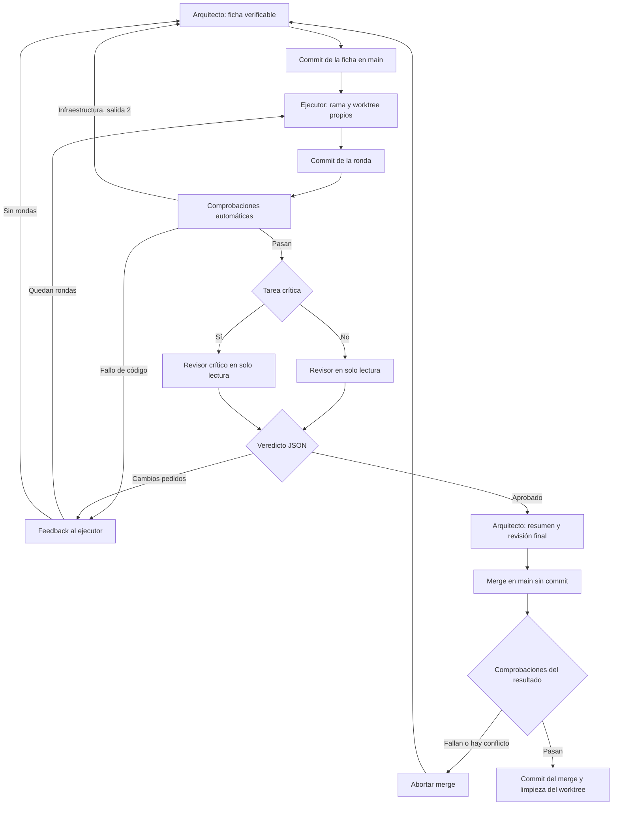

# Cómo funciona

El arquitecto es Claude Code con Opus. El ejecutor y los revisores son procesos de Codex CLI. Cada herramienta necesita su propia sesión autenticada. Los scripts unen sus resultados mediante archivos y Git.

1. El arquitecto escribe `.agents/tasks/T-001.md`. La ficha define qué se debe conseguir, qué archivos se pueden tocar y cómo demostrarlo. Guarda la ficha y las reglas en main.
2. `run-task.ps1` crea `task/T-001` y un *worktree*: otra carpeta del mismo repositorio. Por defecto queda en `.agentloop-worktrees/T-001`. Cada tarea tiene una carpeta y rama diferentes.
3. Codex recibe la ficha y trabaja con sandbox `workspace-write`. El script valida su resultado JSON y guarda un commit local de los cambios. El ejecutor no hace el commit por su cuenta.
4. `gates.ps1` ejecuta las comprobaciones fuera del sandbox del ejecutor. Código 0 significa que pasan; 1, que hay un fallo; 2, que falta infraestructura o no se puede ejecutar la comprobación de forma fiable.
5. Si pasan, otro proceso de Codex revisa en `read-only`. Recibe la ficha y el diff; puede consultar archivos. Devuelve un JSON con veredicto, incidencias y evidencia de los criterios. Un JSON inválido, un proceso fallido o un criterio pendiente no aprueban la tarea.
6. Los fallos vuelven al ejecutor con el detalle. Al agotarse el bloque de rondas, decide el arquitecto. Un relanzamiento conserva los archivos anteriores y continúa la numeración.
7. El arquitecto lee el resumen y el veredicto. Si decide integrar, `merge-task.ps1` comprueba que se trata del mismo commit aprobado, mezcla los cambios en main sin crear aún el commit y repite los gates. Solo si pasan crea el commit del merge.

## Qué archivos mirar

Todo el diagnóstico está en `.agents/runs/T-001/`, una carpeta ignorada por Git:

| Archivo | Qué contiene |
|---|---|
| `status.json` | Estado, modelos, ronda y commit aprobado |
| `summary.md` | Resumen para el arquitecto y tamaño de los cambios |
| `round-N.prompt.md` | Ficha y feedback enviados al ejecutor |
| `round-N.result.json` | Resultado declarado por el ejecutor |
| `round-N.gates.txt` | Salida de las comprobaciones |
| `round-N.review.json` | Veredicto y problemas detectados |
| `round-N.exec.log`, `round-N.review.log` | Actividad de las CLI |
| `merge.gates.txt` | Comprobaciones sobre el resultado integrado |

`node scripts/agent/board.mjs` muestra la tabla. `/flota` añade los subagentes de Claude a las ejecuciones de Codex. El tablero y la banda muestran `interrupted` cuando no cambia ningún archivo de la ejecución durante el umbral configurado; no matan procesos ni cambian el resultado de una revisión.

## Límites deliberados

El script no interpreta `depends_on`: el arquitecto debe resolver esas dependencias antes de lanzar. Los comandos escritos en una ficha tampoco se descubren automáticamente: deben estar en los scripts del lenguaje o en `gates`. Los IDs admitidos son `T-` seguido de al menos tres dígitos.

El bucle crea commits locales. El push, los despliegues y las acciones externas necesitan confirmación humana. La protección de secretos y las guardas son ayudas locales, no un aislamiento de seguridad completo.
